<div align="center">

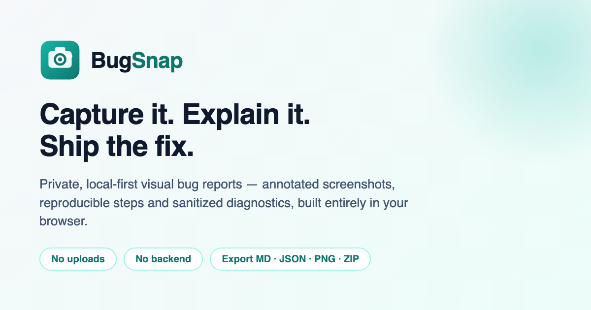

# BugSnap

**Private, local-first visual bug reporting & reproduction studio**

Capture it. Explain it. Ship the fix. — A clearer bug report starts with better evidence.

[](https://github.com/singhtanishq/BugSnap/actions/workflows/ci.yml)

</div>

---

BugSnap turns a screenshot, reproduction steps and optional diagnostics into a clear, shareable bug report — **without uploading anything to a BugSnap server**. There is no server, no account and no analytics: the app is a static site that runs entirely in your browser tab.

## Use cases

- **QA engineers** writing reproducible, annotated defect reports.
- **Developers** filing issues for teammates with the exact context needed to reproduce.
- **Product managers and designers** documenting UI problems with visual evidence.
- **Students and open-source contributors** preparing well-structured GitHub issues.
- **Support engineers** collecting customer-reported problems without shipping customer data to a third party.

## Key features

- **Guided report builder** — title, description, type, severity, priority, status, area, expected/actual results, frequency, regression flag, preconditions, labels and assignee (free text, no tracker integration).
- **Reproduction steps** — ordered, editable, renumber automatically, support prerequisites, observed results and evidence attachment, plus an editable quick template.
- **Evidence intake** — upload, drag-and-drop, clipboard paste, and explicit `getDisplayMedia` screen capture with immediate stream teardown and full error handling.
- **Annotation studio** — arrow, rectangle, ellipse, freehand pen, text label, numbered marker and **opaque redaction** on a scalable canvas with undo/redo, zoom/pan, keyboard shortcuts and non-destructive JSON annotations.
- **Environment snapshot** — local feature detection with honest "detected / browser-reported" labels; every field is opt-in, including the user-agent string.
- **Diagnostics** — paste or import console logs; scan with 14 deterministic detector categories plus validated custom rules; import HAR files for a hostname-only summary with a confirmed, sanitized export path.
- **Redaction engine** — findings with line/column, masked previews, per-finding redact/ignore, manual selection redaction, and replacements applied to the export data itself.
- **Exports** — Markdown, versioned JSON, flattened PNG evidence, ZIP bundle with README, and GitHub/Jira/Linear clipboard templates (no live integrations).
- **Optional local drafts** — IndexedDB persistence strictly behind explicit opt-in, with disable-and-delete semantics.
- **Privacy center** — a precise map of what lives in memory, IndexedDB and exports, plus clear-data actions.

## Privacy model and honest limitations

BugSnap's promise is narrow and checkable:

- **No BugSnap backend.** Report contents, images, logs and HAR data are processed in the tab and stay there.
- **Data stays in memory by default.** Closing the tab discards everything unless you enabled drafts or exported files.
- **IndexedDB is opt-in only**, used solely for drafts, and stores them **unencrypted** in the browser profile — it is not a secure vault.
- **Screen capture is explicit.** Your browser's chooser decides what is shared; BugSnap reads one still frame and stops every track immediately.
- **Automated redaction is a helper, not a guarantee.** Detectors are deterministic heuristics; you must review every export before sharing it.
- **The hosting provider still sees ordinary request logs.** GitHub Pages processes standard request metadata (IP, URL, timestamp) — BugSnap cannot change that, and no report content is part of those requests beyond normal page loads.
- **Files only leave your device when you save an export yourself.** Copy-to-clipboard templates are also under your control.

See [docs/privacy/privacy-model.md](docs/privacy/privacy-model.md) for the full model and [docs/privacy/redaction-limitations.md](docs/privacy/redaction-limitations.md) for redaction caveats.

## Supported inputs

| Input | Formats | Limits | Notes |
| --- | --- | --- | --- |
| Image evidence | PNG, JPG/JPEG, WEBP | 20 MB each · 50 MP guard | Upload, drag-drop, paste, explicit capture |
| Console output | pasted text, `.txt`, `.log` | 5 MB (truncated with warning) | Parsed in a Web Worker |
| HTTP Archive | `.har` | 20 MB · 50,000 entries | Summarised locally; raw file never exported |
| Exports | `.md`, `.json`, `.png`, `.zip` | — | Generated in-browser, saved by you |

## Workflow

```text
Overview → New Report → Reproduction Steps → Evidence & Annotation
        → Environment → Diagnostics → Privacy Review → Preview → Export MD/JSON/PNG/ZIP
```

You can move backwards and forwards at any point without losing input; the sidebar progress indicator reflects real completion state.

## Installation and local development

Requirements: Node.js 20+ and pnpm 10+ (npm works too, but pnpm is the committed lockfile).

```bash
git clone https://github.com/singhtanishq/BugSnap.git
cd BugSnap
pnpm install
pnpm dev            # http://localhost:5173
```

## Build, lint, typecheck and test

```bash
pnpm build          # typecheck + production build to dist/ (base path /BugSnap/)
pnpm typecheck      # tsc -b
pnpm lint           # eslint
pnpm format:check   # prettier
pnpm test           # vitest unit + integration suites
pnpm test:e2e       # Playwright E2E (starts/reuses dev server on :5199)
pnpm screenshots    # regenerate docs/screenshots from the running app
pnpm validate:screenshots
pnpm exec playwright install chromium   # one-time browser download for E2E
```

The production network audit (fails if any request leaves the app origin):

```bash
pnpm build
node scripts/audit-runtime-network.mjs
```

## Architecture overview

```text
Browser tab (all processing happens here)
├── React + TypeScript UI (Vite, Tailwind CSS 4, hash router for /BugSnap/)
│   ├── features/overview · report-builder · reproduction-steps · evidence
│   ├── features/annotation (canvas studio) · environment · diagnostics
│   ├── features/review · export UI · local-drafts · privacy · help
│   └── components/ui (design system) · components/feedback (toasts, errors)
├── lib/
│   ├── annotation/  geometry · history · render · flatten (export PNG)
│   ├── redaction/   patterns (14 detectors + Luhn) · apply (export path)
│   ├── har/         parse (summary) · sanitize (confirmed copies)
│   ├── export/      markdown · json · templates · bundle (ZIP) · filenames
│   ├── validation/  URL sanitizer · export readiness
│   ├── browser/     environment detection · screen capture
│   ├── files/       evidence blob store · raw-HAR memory store · limits
│   └── storage/     IndexedDB drafts (opt-in)
├── workers/  log-scan.worker · har-parse.worker (keep the UI responsive)
└── types/    versioned domain models (report, annotation, diagnostics, redaction)
```

Data flow: **input → validate → in-memory state (React reducer) → pure serializers → Blob downloads.** Binary evidence never enters React state; the raw HAR never enters report state. Full details in [docs/architecture/overview.md](docs/architecture/overview.md) and [docs/architecture/data-flow.md](docs/architecture/data-flow.md).

## Export formats and ZIP layout

| Export | Contents |
| --- | --- |
| `report.md` | Human-readable Markdown with stable sections, sanitized console, HAR summary, evidence references |
| `report.json` | `schemaVersion: 1`, generator metadata, report fields, evidence references, diagnostics — no blobs, no secrets |
| `evidence/*.png` | Flattened annotated/redacted images (or untouched originals when chosen) |
| `diagnostics/console-sanitized.txt` | Console text with redacted findings applied |
| `diagnostics/har-sanitized.har` | Sanitized HAR copy (only after explicit preparation) |
| `README.txt` | Bundle manifest + privacy reminder |

```text
bugsnap-report-YYYY-MM-DD/
├── report.md
├── report.json
├── evidence/
│   ├── screenshot-01.png
│   └── screenshot-02.png
├── diagnostics/
│   ├── console-sanitized.txt
│   └── har-sanitized.har        (only when prepared and included)
└── README.txt
```

The JSON schema is documented in [docs/export-schema.md](docs/export-schema.md).

## GitHub Pages deployment

The production build targets the project subpath `/BugSnap/` with hash routing, so deep links and refreshes work without server rewrites. `.github/workflows/ci.yml` runs lint, typecheck, tests, build and the screenshot validator on every push; `.github/workflows/deploy-pages.yml` deploys the build output to GitHub Pages via the official actions. The expected public URL, once deployment completes, is:

**https://singhtanishq.github.io/BugSnap/**

## Security notes and redaction caveats

- All uploaded files, pasted logs and HAR content are treated as **untrusted input**: rendered as text, never `innerHTML`-injected, MIME+extension validated, size-capped, decoded in guarded paths.
- User-defined regex rules are length-limited, compile-checked and smoke-tested against backtracking before use; heavy scanning runs in workers.
- Media streams stop on success, failure and cancellation; object URLs are revoked deterministically.
- A production-build audit (`scripts/audit-runtime-network.mjs`) and a Playwright test fail the build if any request leaves the app origin.
- **Redaction is best-effort:** opaque redaction rectangles are flattened into exported pixels (pixel-verified in E2E), and sanitized text/HAR replace values in the export data itself — but no automated scan can promise completeness. Review before sharing. See [docs/privacy/redaction-limitations.md](docs/privacy/redaction-limitations.md).

## Known limitations

See [docs/known-limitations.md](docs/known-limitations.md) for the maintained list. Highlights: screen capture needs a secure context and browser support; browser/OS detection is approximate; one tab cannot read another tab's DevTools console; drafts are unencrypted; there are deliberately no live tracker integrations.

## Testing

- **116 unit/integration tests** (Vitest + Testing Library): validation, sanitization, redaction patterns, Luhn, HAR parse/sanitize, annotation geometry/history, export content, URL handling, drafts.
- **Playwright E2E**: the full workflow with real downloads and byte-level verification (Markdown/JSON/ZIP contents, PNG pixel checks proving opaque redaction), draft lifecycle in real IndexedDB, same-origin network audit, WCAG 2.0/2.1 AA axe audits on every page at desktop and mobile, and keyboard navigation.
- See [docs/testing/test-plan.md](docs/testing/test-plan.md) and [docs/testing/browser-compatibility.md](docs/testing/browser-compatibility.md).

## Screenshots

All screenshots below were captured from the real running application by [scripts/capture-screenshots.mjs](scripts/capture-screenshots.mjs) using the clearly-labelled synthetic sample report — no mockups, no image editors.

### 01 — Overview

The entry point: start a new report, load the clearly-labelled synthetic sample, and see the workflow at a glance.

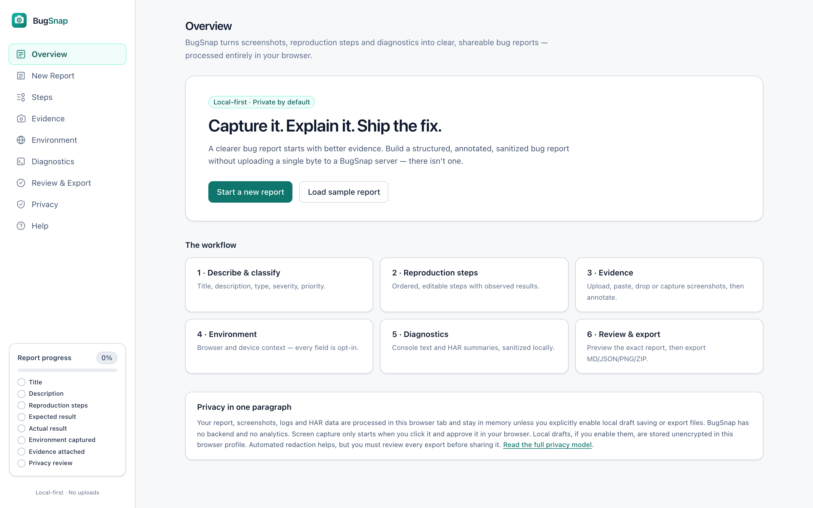

### 02 — Report builder

Describe and classify the issue. Required fields are marked; the affected URL is opt-in and sanitized before it is ever stored.

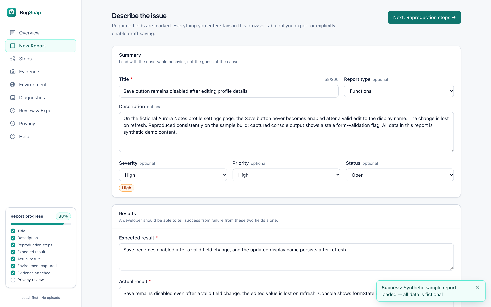

### 03 — Reproduction steps

Ordered steps with observed results, prerequisites, evidence attachment, and a quick template of editable placeholders.

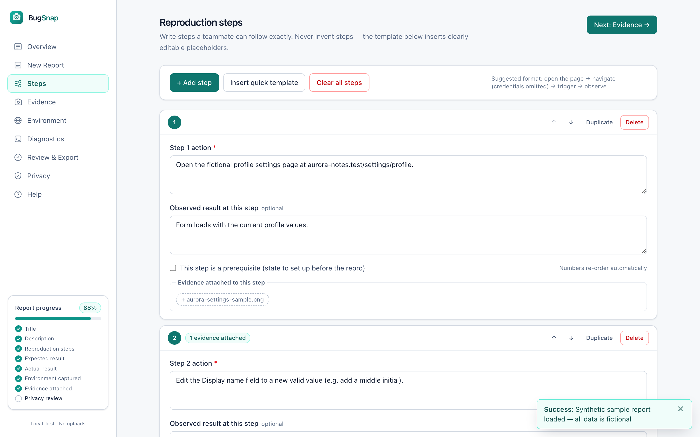

### 04 — Evidence workspace

Upload, drag-and-drop, paste or explicitly capture screenshots. Each item shows dimensions, size and export controls.

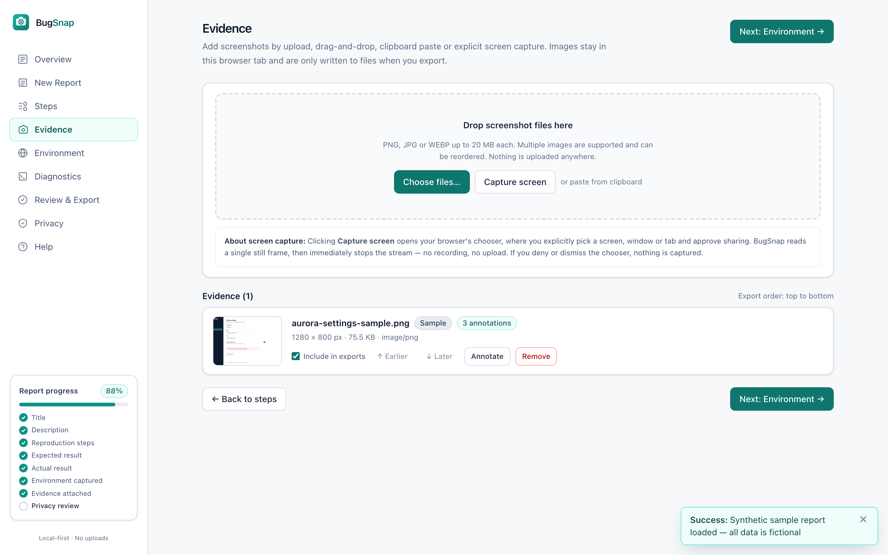

### 05 — Annotation studio

The full canvas editor: arrow, rectangle, ellipse, pen, text, numbered markers and opaque redaction, with undo/redo, zoom/pan, colour/stroke controls and keyboard shortcuts.

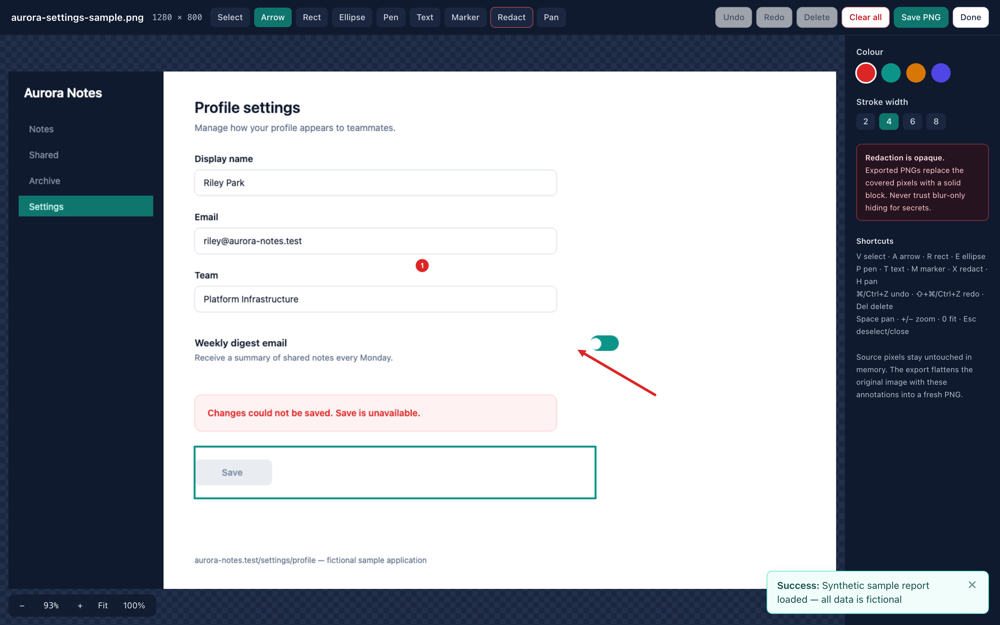

### 06 — Diagnostics and console redaction

Paste or import console output; deterministic detectors list findings with line/column and masked previews.

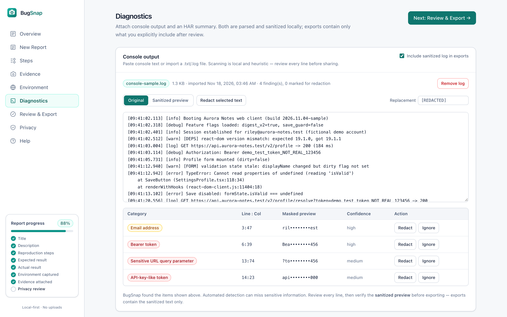

### 07 — HAR review

A hostname-only request summary with failed/4xx/5xx counts and honest browser-reported observations. Raw HAR files are never attached to exports; the sanitized copy requires explicit preparation.

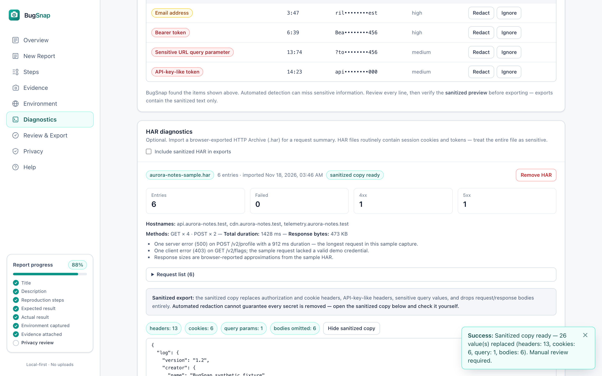

### 08 — Redaction review

The sanitized preview is computed on the exact export path: redacted findings are replaced in the text itself, never merely hidden.

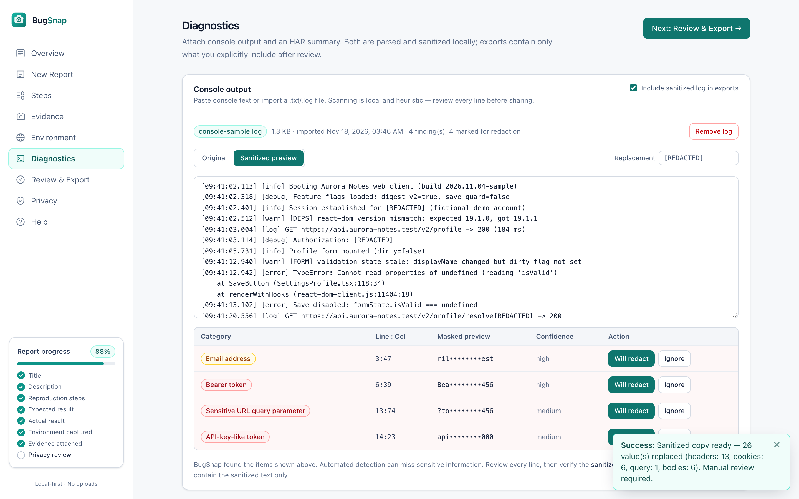

### 09 — Report preview

Exactly what an export will contain, section by section — including which environment fields, evidence and diagnostics are included.

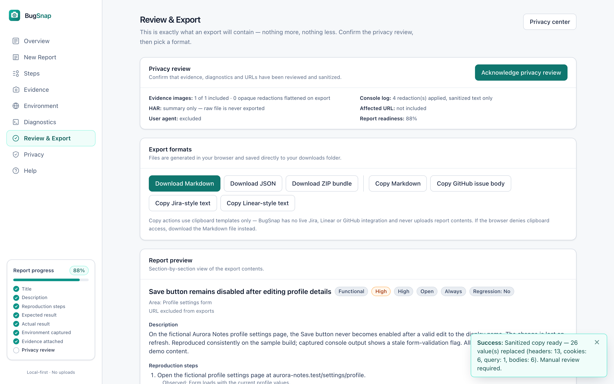

### 10 — Export options

Markdown, JSON and ZIP downloads plus GitHub/Jira/Linear clipboard templates with explicit no-live-integration disclaimers.


### 11 — Privacy center

Where every piece of data lives, opt-in draft controls with storage usage, and clear-data actions.

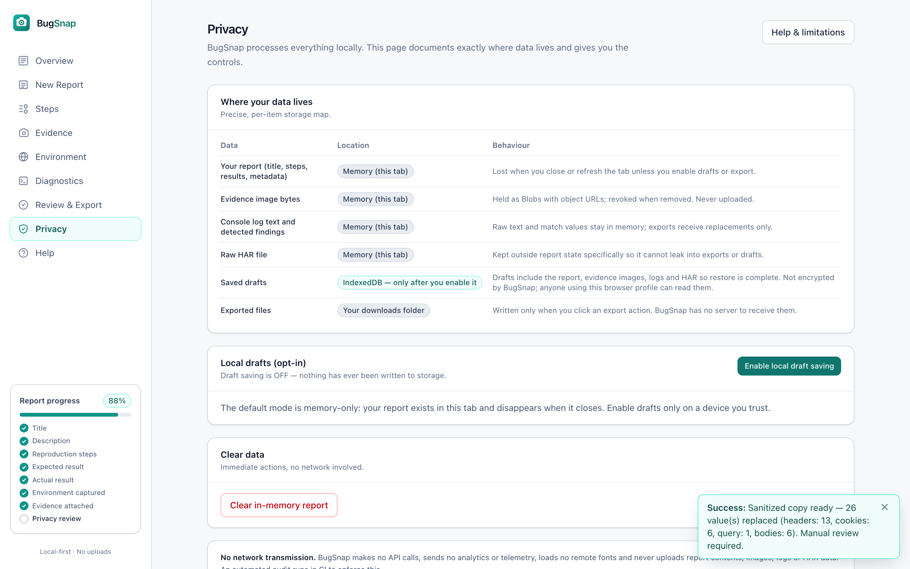

### 12 — Mobile layout

Single-column guided workflow with a collapsible menu — every core action stays reachable.

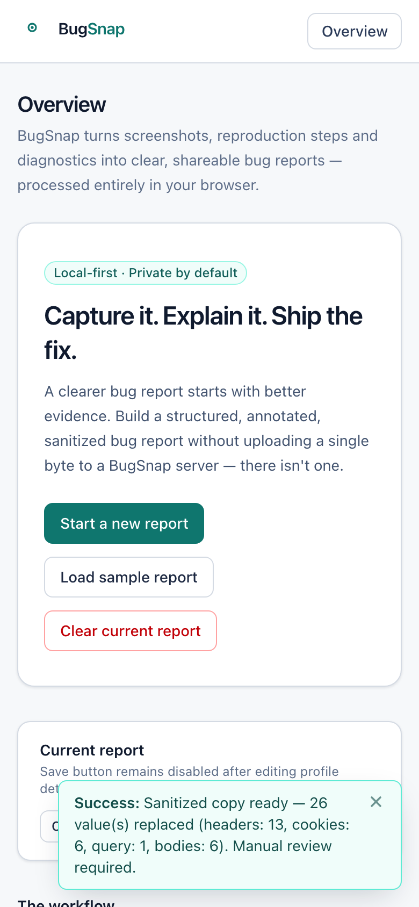

## Documentation

- [Architecture overview](docs/architecture/overview.md) · [Data flow](docs/architecture/data-flow.md)
- [Privacy model](docs/privacy/privacy-model.md) · [Redaction limitations](docs/privacy/redaction-limitations.md)
- [Test plan](docs/testing/test-plan.md) · [Browser compatibility](docs/testing/browser-compatibility.md)
- [Export JSON schema](docs/export-schema.md) · [Known limitations](docs/known-limitations.md)

## Contributing and license

This is a personal project; there is no contribution process or license file established yet. If that changes, this section will be updated to reflect reality.
